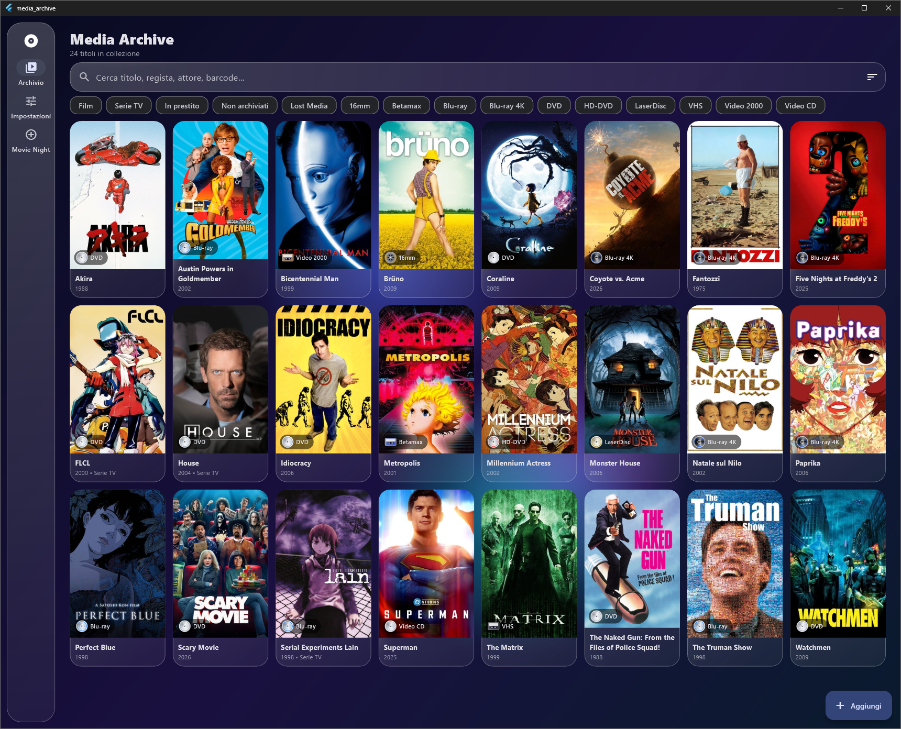
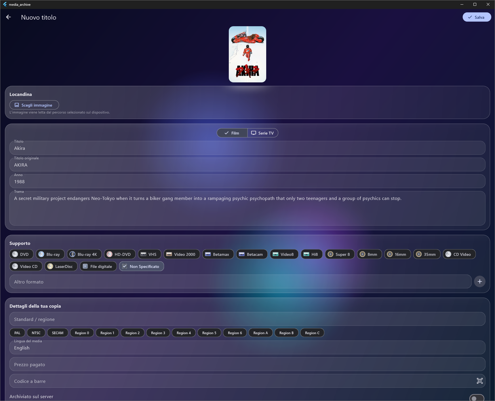
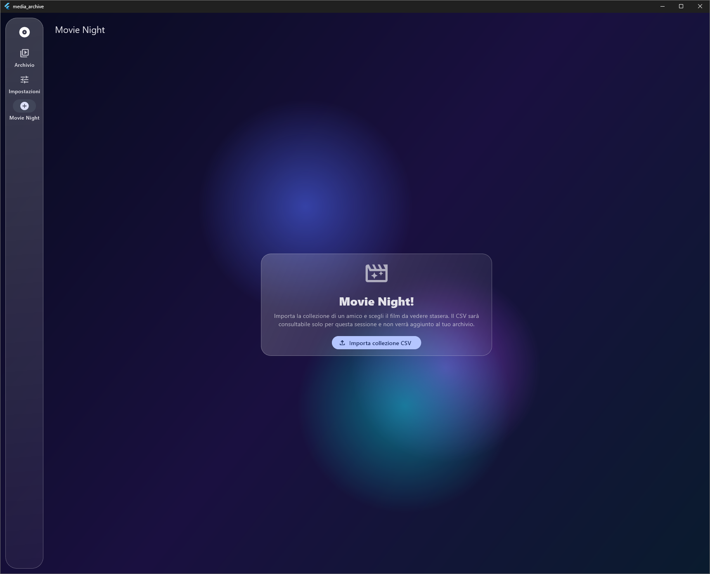
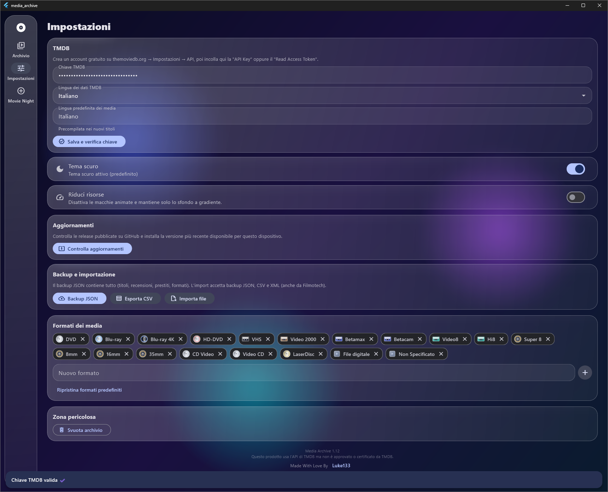

# Media Archive


A personal catalogue for physical film and television collections. Track DVDs, Blu-rays, VHS tapes, LaserDiscs and other formats, browse TMDB metadata, manage loans and reviews, and bring a friend's CSV collection to **Movie Night**.

Built with Flutter for Windows, Linux, macOS, Android, iOS and the web. Your library is stored locally on your device.

## Screenshots

<p align="center">
  
</p>
<p align="center">
  
  
</p>
<p align="center">
  
  
</p>

These screenshots show the app with sample data. Avoid adding personal notes, barcodes or loan details to future captures.

## Features

- Search movies and series on **TMDB** and import posters, summaries, cast, crew, ratings and other available metadata.
- Add or edit titles manually, including titles without a TMDB match. Replace a linked title or refresh its information later.
- Browse a title's available TMDB poster and backdrop gallery; choose a local cover image when you prefer one.
- Track physical formats such as DVD, Blu-ray, VHS, LaserDisc, HD-DVD, CED and custom formats.
- Save region, language, price, barcode, notes, personal review and half-star rating; rate physical copy quality with half-disc steps.
- Mark a title as watched, archived on your server, or **Lost Media**. Search and filter the collection, including a Lost Media filter.
- Track loans, borrowers and return dates.
- **Movie Night:** import a friend's CSV into a temporary, searchable collection. It is kept separate from your own library and is not saved after leaving the session.
- Import and export CSV; import JSON/CSV/XML, including Filmotech files; create a full JSON backup.
- Choose the light or dark theme, reduce animated background effects, and check GitHub for new releases.
- Switch the interface between English and Italian. English is selected by default; TMDB data language remains a separate setting.

## Download and install

Open [Releases](https://github.com/Luke133yt/Media-Archive/releases/latest) and choose the package for your platform:

| Platform | Release file | Install/update notes |
| --- | --- | --- |
| Windows 10/11, x64 | `media-archive-windows-setup.exe` | Per-user installer. New versions can be downloaded and installed by the in-app updater. |
| Linux, x64 | `media-archive-linux-x64.tar.gz` | Extract the bundle and run `bundle/media_archive`. |
| macOS | `media-archive-macos.zip` | Extract and move `media_archive.app` to Applications. The build is not notarized. |
| Android | `media-archive-android.apk` | Open the APK and confirm installation. Keep the same signing key when updating. |
| Web | `media-archive-web.zip` | Static site bundle for a web host; a release does not deploy the site by itself. |

There is no signed iOS package in the automated release workflow. iOS distribution needs Apple signing credentials and App Store Connect/TestFlight setup.

### In-app updates

At startup the app checks the repository's public GitHub Releases API. A newer version opens a prompt with **Remind me later** and a platform-specific update action. Dismissing the prompt stores that release tag, so it does not reappear on every launch; the next release can still be announced. You can also check from **Settings → Updates**.

On Windows, the app downloads the matching installer with a progress bar, starts the per-user installer, and restarts the application. The installer replaces program files only; the local database and preferences are stored separately and are not removed. On Linux and macOS the app opens the matching package download; the user completes the platform-specific replacement. Android requires the system's APK installation confirmation. iOS updates must come through the store used to install the app.

## Build from source

### Requirements

- Flutter **3.27 or newer** and its bundled Dart SDK
- Git
- Platform-specific tools: Visual Studio with **Desktop development with C++** for Windows; Xcode for macOS/iOS; Android Studio or Android SDK for Android; GTK 3 development libraries for Linux

Check your setup:

```sh
flutter doctor -v
```

Clone and fetch dependencies:

```sh
git clone https://github.com/Luke133yt/Media-Archive.git
cd Media-Archive
flutter pub get
```

Run the app:

```sh
flutter run -d windows   # Windows
flutter run -d linux     # Linux
flutter run -d macos     # macOS
flutter run -d chrome    # Web
flutter run              # connected device or emulator
```

The optional `setup.bat` and `setup.sh` scripts regenerate Flutter's platform folders and fetch packages. Use them only when those generated folders are missing; ordinary source changes need just `flutter pub get`.

### TMDB setup

1. Create an account at [themoviedb.org](https://www.themoviedb.org/).
2. Open **Settings → API** in your TMDB account and create an API credential.
3. In Media Archive, open **Settings**, paste either the TMDB API key or Read Access Token, and press **Save and verify key**.

The app uses TMDB for catalogue metadata and displays its attribution in the settings page. Review [TMDB's terms](https://www.themoviedb.org/terms-of-use).

## Build locally

Run the relevant command from the project root:

```sh
flutter build windows --release
flutter build linux --release
flutter build macos --release
flutter build apk --release
flutter build ipa --release       # macOS + Apple signing setup required
flutter build web --release
```

The GitHub workflow produces distributable Windows, Linux, macOS, Android and web artifacts. Its output files appear on the repository's **Releases** page; a Linux bundle is not a Debian/RPM installer, and the macOS archive is not notarized.

## Publish a release with GitHub Actions

The workflow at [`.github/workflows/release.yml`](.github/workflows/release.yml) builds the platform packages and creates a GitHub Release when a version tag is pushed. It checks that the tag matches `version:` in `pubspec.yaml`.

### 1. Configure Android signing once

Android will reject an update if the new APK is signed with a different key. Create and safely back up one upload keystore; never commit it or send it in chat:

```sh
keytool -genkeypair -v -keystore upload-keystore.jks -keyalg RSA -keysize 2048 -validity 10000 -alias media-archive
```

Convert it to Base64 locally (Python works on Windows, macOS and Linux):

```sh
python -c "import base64,pathlib; print(base64.b64encode(pathlib.Path('upload-keystore.jks').read_bytes()).decode())"
```

In GitHub, open **Settings → Secrets and variables → Actions → New repository secret** and add:

- `ANDROID_KEYSTORE_BASE64` — the Base64 output
- `ANDROID_KEY_ALIAS` — `media-archive` (or the alias you chose)
- `ANDROID_KEY_PASSWORD` — the key password
- `ANDROID_STORE_PASSWORD` — the keystore password

The workflow uses these secrets to sign each APK. If you lose or replace the keystore, Android will not install that APK as an update over the existing app.

### 2. Set the version and create a tag

For example, change the version line in `pubspec.yaml` to `version: 1.13.0+13`, commit the change, then push a matching tag:

```sh
git add pubspec.yaml
git commit -m "Prepare release 1.13.0"
git tag v1.13.0
git push origin main --tags
```

GitHub Actions builds the packages and publishes a release with generated notes. Watch progress under the repository's **Actions** tab. If a build fails, fix the reported platform issue and push a new version/tag; a published tag should not be reused for different binaries.

No personal access token is required in the app or workflow: GitHub Actions uses its scoped `GITHUB_TOKEN`. Do not paste account passwords, API keys or signing secrets into source files or chat.

### 3. Signing and platform distribution

- Windows installer and macOS app are not code-signed in this workflow. Windows SmartScreen and macOS Gatekeeper may show a warning. Commercial signing/notarization credentials can be configured later as repository secrets.
- Android APK is signed with the repository's upload keystore.
- iOS requires an Apple Developer account, certificates, provisioning profiles and App Store Connect/TestFlight. Do not distribute an unsigned IPA.
- Web files need to be uploaded to a web host separately. Publishing a GitHub Release does not update a running website.

## Platform notes

- **Windows:** install Visual Studio with the C++ desktop workload. The release installer installs into the current user's profile and does not require administrator access.
- **Linux:** Flutter desktop builds need `clang`, `cmake`, `ninja-build`, `pkg-config`, `libgtk-3-dev` and `liblzma-dev`. File dialogs may also need `zenity` or `kdialog`.
- **Android:** barcode scanning uses the camera; the app needs the camera permission. Use a persistent upload keystore for release APKs.
- **iOS:** add camera usage text to `ios/Runner/Info.plist` and configure Apple signing before distribution.
- **macOS:** camera and network access require the corresponding app entitlements; distribution outside the App Store also requires signing/notarization for a seamless first launch.
- **Web:** browser storage is local to that browser and is not synced to other devices. Camera access and third-party barcode services may be limited by browser permissions or CORS.

## Data and backups

The collection and preferences are stored locally using `shared_preferences`; there is no cloud synchronization. Windows/Linux/macOS and mobile updates do not intentionally clear application data. On Android, updates also need the same application ID and signing key. Browser data remains in that browser profile. Use **Settings → Backup and import → JSON backup** before moving to another device or reinstalling.

Movie Night reads the selected CSV into temporary in-memory state and does not merge those titles into your personal database.

## Repository map

```text
lib/
  main.dart             app startup, navigation and theme
  models.dart           media, cast, reviews and loan data models
  store.dart            application state and local persistence
  tmdb.dart             TMDB API client
  io_service.dart       CSV/JSON/XML import and export
  update_service.dart   GitHub release check and update prompt
  ui/                   library, editing, settings and Movie Night screens
installer/
  windows.iss           per-user Windows installer definition
.github/workflows/
  release.yml           tagged multi-platform release builds
docs/screenshots/       README screenshots
```

## Known limitations

- The barcode lookup uses UPCitemdb, which has usage limits and may be blocked by browser CORS. A scanned barcode is retained even when no title is found.
- Some Filmotech exports use custom column names; import mappings live in `lib/io_service.dart` and can be extended for a sample file.
- TMDB reviews are often available only in English.
- Releases are built from the tag. The in-app update prompt can only offer versions that have been published as GitHub Releases.
